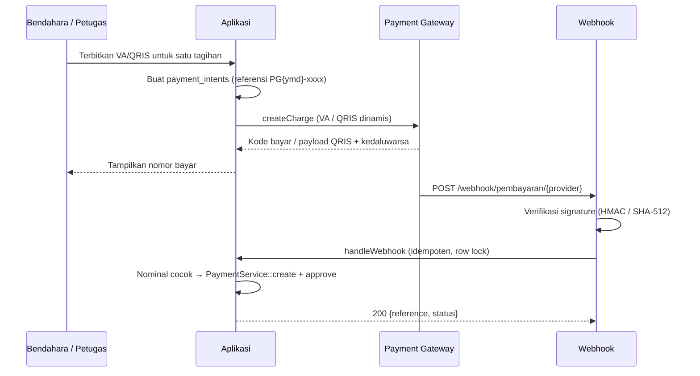

# API INTEGRATION — KOMITE MAN 7 JOMBANG

Dokumen ini menjelaskan rencana integrasi layanan pihak ketiga.

**Status saat ini:** belum ada integrasi eksternal yang aktif (Fase 1–2 hanya
menggunakan basis data internal). Dokumen ini menjadi acuan implementasi pada
Fase 7 (System Tools).

Per `AGENTS.MD` bagian 2.1, API eksternal **hanya** digunakan untuk kebutuhan
WhatsApp, email, payment gateway, atau sistem pihak ketiga. Backend API terpisah
untuk kebutuhan internal aplikasi **dilarang**.

---

## 1. Prinsip Umum

1. **Tanpa kredensial di source code.** Seluruh API key, token, dan password
   disimpan di `.env` atau pada `app_settings` yang terenkripsi.
2. **Selalu melalui queue.** Pengiriman notifikasi tidak boleh memblokir response
   pengguna. Gunakan `QUEUE_CONNECTION=database` dan `php artisan queue:work`.
3. **Idempoten.** Setiap permintaan keluar memiliki kunci idempoten atau
   `notification_logs` agar tidak terkirim ganda.
4. **Terekam.** Setiap panggilan dicatat pada `notification_logs`
   (status, request, response, waktu).
5. **Gagal dengan aman.** Kegagalan integrasi tidak boleh menggagalkan transaksi
   keuangan. Transaksi tersimpan lebih dulu, notifikasi menyusul.
6. **Tanpa data sensitif di log.** Jangan mencatat password, token, atau isi
   pesan yang memuat data pribadi lengkap.

---

## 2. Integrasi WhatsApp

### 2.1 Penyedia

Rekomendasi: penyedia gateway WhatsApp Business API lokal (mis. Fonnte,
Wablas, atau WA Business API resmi Meta). Antarmuka aplikasi dibuat melalui
abstraksi `WhatsAppGateway` agar penyedia dapat diganti tanpa mengubah domain.

### 2.2 Konfigurasi

```env
WHATSAPP_ENABLED=true
WHATSAPP_PROVIDER=fonnte
WHATSAPP_API_URL=https://api.fonnte.com
WHATSAPP_API_TOKEN=
WHATSAPP_SENDER=
```

Tambahkan pada `config/services.php`:

```php
'whatsapp' => [
    'enabled'  => env('WHATSAPP_ENABLED', false),
    'provider' => env('WHATSAPP_PROVIDER', 'fonnte'),
    'url'      => env('WHATSAPP_API_URL'),
    'token'    => env('WHATSAPP_API_TOKEN'),
    'sender'   => env('WHATSAPP_SENDER'),
],
```

### 2.3 Rencana Kelas

```text
app/Services/Notification/WhatsAppGateway.php        (interface)
app/Services/Notification/FonnteGateway.php          (implementasi)
app/Services/Notification/WablasGateway.php          (implementasi)
app/Jobs/SendWhatsAppNotification.php                (queue job)
app/Notifications/StudentBillReminder.php            (notification)
```

### 2.4 Kasus Penggunaan

| Trigger | Penerima | Isi Pesan |
|---|---|---|
| Tagihan baru diterbitkan | `students.parent_phone` | Nominal tagihan, jatuh tempo, rekening tujuan |
| Pengingat H-3 jatuh tempo | `students.parent_phone` | Sisa tagihan, tautan portal |
| Pembayaran terverifikasi | `students.parent_phone` | Nominal diterima, sisa tagihan, nomor kwitansi |
| Tagihan menunggak > 30 hari | `students.parent_phone` | Total tunggakan, imbauan penyelesaian |

### 2.5 Format Nomor

Nomor disimpan pada `students.parent_phone` dan `staff_profiles.phone`.
Normalisasi wajib sebelum pengiriman:

```text
08xxxxxxxxxx  ->  628xxxxxxxxxx
+628xxxxxxxxxx -> 628xxxxxxxxxx
```

### 2.6 Penanganan Kegagalan

- Percobaan ulang otomatis 3 kali dengan jeda eksponensial (`backoff`).
- Setelah 3 kegagalan, status pada `notification_logs` menjadi `failed`.
- Kegagalan tercatat dan dapat dikirim ulang manual dari halaman log notifikasi.

---

## 3. Integrasi Email

### 3.1 Konfigurasi

Gunakan driver bawaan Laravel. Contoh SMTP:

```env
MAIL_MAILER=smtp
MAIL_HOST=smtp.gmail.com
MAIL_PORT=587
MAIL_USERNAME=noreply@man7jombang.sch.id
MAIL_PASSWORD=
MAIL_ENCRYPTION=tls
MAIL_FROM_ADDRESS="noreply@man7jombang.sch.id"
MAIL_FROM_NAME="${APP_NAME}"
```

### 3.2 Kasus Penggunaan

- Kwitansi pembayaran (lampiran PDF).
- Rekap tagihan bulanan ke orang tua/wali.
- Undangan dan informasi PPDB.
- Notifikasi internal untuk verifikator saat ada pembayaran menunggu verifikasi.

### 3.3 Rencana Kelas

```text
app/Mail/BillReminderMail.php
app/Mail/PaymentReceiptMail.php
app/Mail/AdmissionInvitationMail.php
```

Seluruh email dikirim melalui queue (`ShouldQueue`) agar tidak memblokir request.

---

## 4. Integrasi Payment Gateway

### 4.1 Status Implementasi

**Sudah diimplementasikan.** Dua penyedia didukung dan dapat dipilih per unit
pendidikan: **Tripay** (Closed Payment) dan **Midtrans** (Core API). Tersedia
pula driver `fake` untuk pengujian tanpa kredensial.

Modul terkait:

| Komponen | Lokasi |
|---|---|
| Kontrak driver | `app/Services/Gateway/PaymentGateway.php` |
| Pemilihan driver | `app/Services/Gateway/GatewayManager.php` |
| Driver Tripay | `app/Services/Gateway/TripayGateway.php` |
| Driver Midtrans | `app/Services/Gateway/MidtransGateway.php` |
| Driver simulator | `app/Services/Gateway/FakeGateway.php` |
| Orkestrasi domain | `app/Services/PaymentGatewayService.php` |
| Endpoint webhook | `app/Http/Controllers/Webhooks/PaymentWebhookController.php` |
| Konfigurasi | `config/payment_gateway.php` |
| Halaman admin | `/pembayaran/tagihan-digital` (`payment-gateways.view`) |

### 4.2 Alur



### 4.3 Aturan yang Ditegakkan

1. **Verifikasi signature** sebelum memproses. Signature tidak valid → `403`
   tanpa menyentuh basis data.
2. **Idempotensi berlapis** — status intent non-`pending` langsung dikembalikan,
   dan `payments.idempotency_key = 'intent:{reference}'` mencegah pembayaran ganda.
3. **Nominal harus cocok.** Bila nominal webhook berbeda, intent ditandai `paid`
   tetapi **tidak** membuat pembayaran; dicatat sebagai
   `payment_intent.amount_mismatch` untuk verifikasi manual.
4. **Satu intent terbuka per tagihan.** Permintaan berulang mengembalikan intent
   yang sama sehingga nomor VA tidak menumpuk.
5. **Audit** — payload webhook terakhir disimpan pada
   `payment_intents.provider_payload`.
6. **Tanpa kredensial di source code** — seluruh nilai sensitif dari `.env`.
7. **Kode bayar terlihat oleh pembayar.** Portal siswa (`/portal/siswa`) dan
   portal orang tua (`/portal/orang-tua`) menampilkan VA/QRIS yang masih
   berlaku per tagihan melalui `PortalService::openIntents()`; kode yang
   kedaluwarsa tidak ditampilkan sehingga pembayar tidak memakai nomor mati.
   Penerbitan tetap dilakukan petugas dari detail tagihan.

### 4.4 Konfigurasi

```env
PAYMENT_GATEWAY_DEFAULT=tripay
PAYMENT_GATEWAY_EXPIRY_HOURS=24

TRIPAY_ENABLED=true
TRIPAY_MODE=production
TRIPAY_BASE_URL=https://tripay.co.id/api
TRIPAY_API_KEY=
TRIPAY_PRIVATE_KEY=
TRIPAY_MERCHANT_CODE=
TRIPAY_CALLBACK_URL=https://domain-sekolah/webhook/pembayaran/tripay

MIDTRANS_ENABLED=false
MIDTRANS_MODE=production
MIDTRANS_BASE_URL=https://api.midtrans.com
MIDTRANS_SERVER_KEY=
MIDTRANS_CLIENT_KEY=
MIDTRANS_MERCHANT_ID=

# Simulator untuk pengujian lokal
PAYMENT_GATEWAY_FAKE_ENABLED=false

# Rekonsiliasi
RECONCILIATION_UNIQUE_AMOUNT=false
RECONCILIATION_DATE_TOLERANCE_DAYS=7
```

Penyedia per unit diatur pada `units.payment_provider`,
`units.payment_channel`, dan `units.payment_gateway_enabled`. Bila unit belum
diatur, aplikasi memakai `PAYMENT_GATEWAY_DEFAULT`.

### 4.5 Catatan Verifikasi Sandbox

Skema signature mengikuti dokumentasi resmi masing-masing penyedia:

- **Tripay** — header `X-Callback-Signature` berisi HMAC-SHA256 dari **raw body**
  dengan private key merchant.
- **Midtrans** — `signature_key` = SHA-512 dari
  `order_id + status_code + gross_amount + server_key`.

Sebelum go-live, wajib diuji terhadap sandbox asli karena penyedia dapat
mengubah detail header/status. Pemetaan status yang dipakai:

| Provider | Status dibayar | Kedaluwarsa | Gagal |
|---|---|---|---|
| Tripay | `PAID` | `EXPIRED` | `FAILED`, `REFUND` |
| Midtrans | `settlement`, `capture` | `expire` | `cancel`, `deny`, `failure` |

---

## 5. Integrasi Rekonsiliasi Bank

Import mutasi rekening koran **tidak** memanggil API bank; berkas CSV/XLSX
diunggah manual oleh bendahara. Karena itu tidak ada kredensial tambahan.

| Komponen | Lokasi |
|---|---|
| Pembaca berkas | `app/Services/Reconciliation/StatementParser.php` |
| Pencocokan | `app/Services/BankReconciliationService.php` |
| Profil bank | `bank_statement_profiles` (seeder: BSI, BRI, Bank Jatim) |
| Halaman admin | `/keuangan/rekonsiliasi-bank` (`bank-reconciliations.view`) |

Urutan aturan pencocokan: **referensi** → **nominal unik** → **nominal +
toleransi tanggal**. Kandidat lebih dari satu sengaja dibiarkan `unmatched`
agar tidak ada penebakan yang merusak data keuangan.

---

## 6. Tabel Pendukung

### `notification_templates`
Menyimpan template pesan yang dapat diedit administrator.

| Kolom | Tipe | Keterangan |
|---|---|---|
| `id` | BIGINT | PK |
| `code` | VARCHAR(60) | Unik, mis: `bill.reminder` |
| `channel` | VARCHAR(20) | `whatsapp` / `email` |
| `subject` | VARCHAR(160) | Subjek (khusus email) |
| `body` | TEXT | Isi dengan placeholder `{{nama}}`, `{{nominal}}` |
| `is_active` | BOOLEAN | Status aktif |

### `notification_logs`
Mencatat setiap percobaan pengiriman.

| Kolom | Tipe | Keterangan |
|---|---|---|
| `id` | BIGINT | PK |
| `notifiable_type` / `notifiable_id` | Morph | Penerima (siswa/petugas) |
| `channel` | VARCHAR(20) | `whatsapp` / `email` |
| `template_code` | VARCHAR(60) | Referensi template |
| `recipient` | VARCHAR(150) | Nomor / alamat tujuan |
| `status` | VARCHAR(20) | `queued` / `sent` / `failed` |
| `response` | TEXT | Respons penyedia |
| `sent_at` | TIMESTAMP | Waktu terkirim |

### `reminder_schedules`
Mengatur jadwal pengingat otomatis.

| Kolom | Tipe | Keterangan |
|---|---|---|
| `id` | BIGINT | PK |
| `name` | VARCHAR(120) | Nama jadwal |
| `channel` | VARCHAR(20) | `whatsapp` / `email` |
| `offset_days` | SMALLINT | H-berapa dari jatuh tempo (negatif = setelah) |
| `is_active` | BOOLEAN | Status aktif |

---

## 7. Keamanan Integrasi

| Ancaman | Mitigasi |
|---|---|
| Kebocoran token API | Simpan di `.env`, jangan commit; gunakan `app_settings` terenkripsi untuk nilai yang diedit admin |
| Webhook palsu | Verifikasi signature / IP allowlist penyedia |
| Replay attack | Idempotency key + pengecekan `notification_logs` |
| Kebocoran data pribadi | Kirim hanya data yang diperlukan; jangan catat isi pesan lengkap di log |
| Notifikasi ganda | Unique constraint pada `(template_code, notifiable_id, periode)` |
| Kegagalan beruntun | Circuit breaker sederhana: nonaktifkan sementara setelah N kegagalan |

---

## 8. Checklist Implementasi Integrasi

- [ ] Kredensial tersimpan di `.env`, tidak ada di repository
- [x] `config/payment_gateway.php` memuat konfigurasi penyedia gateway
- [x] Gateway diimplementasikan melalui interface (dapat diganti)
- [x] Pengiriman melalui queue job
- [ ] Percobaan ulang dengan backoff
- [x] Setiap percobaan tercatat di `notification_logs`
- [x] Normalisasi nomor WhatsApp
- [x] Template pesan dapat diedit administrator
- [x] Feature test dengan fake HTTP client (`GatewayDriverTest`)
- [x] Kegagalan integrasi tidak menggagalkan transaksi keuangan
- [x] Webhook menolak tanda tangan tidak valid (403) dan referensi tak dikenal (422)
- [ ] Verifikasi skema signature terhadap sandbox asli Tripay/Midtrans sebelum go-live
