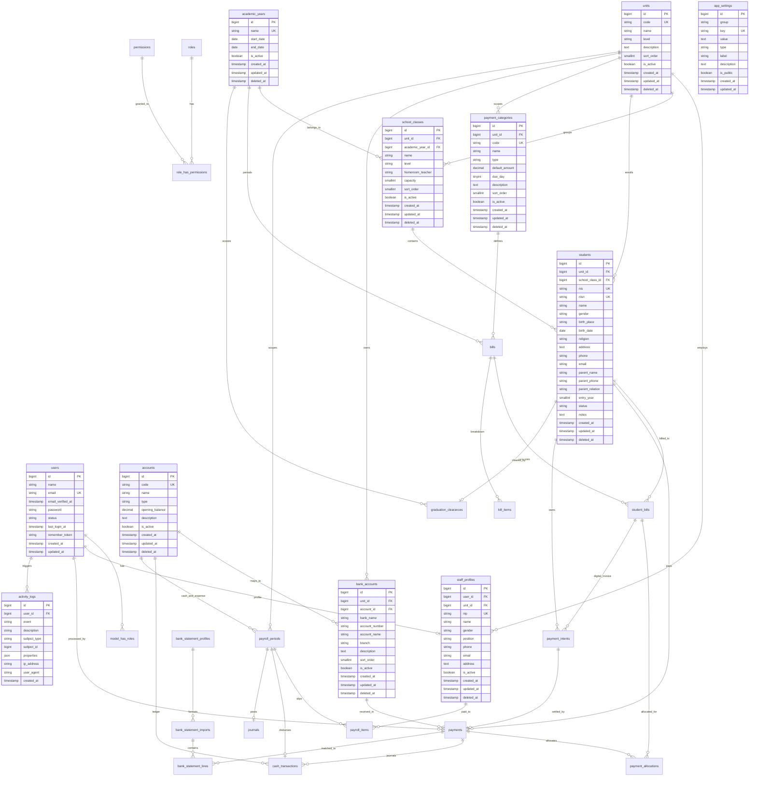

# DATABASE ERD — KOMITE MAN 7 JOMBANG

Dokumen ini mendefinisikan skema basis data aplikasi **KOMITE MAN 7 JOMBANG**
sesuai aturan pada `AGENTS.MD` bagian 5 dan `DESIGN.MD`.

Basis data utama: **MySQL 8.x**  
Karakter set: `utf8mb4_unicode_ci`  
Engine: `InnoDB`  
Zona waktu: `Asia/Jakarta`  
Mata uang: `IDR` — seluruh kolom uang wajib `decimal(15, 2)`.

---

## 1. Diagram Relasi Entitas (ERD)



---

## 2. Struktur Tabel Master Data (Tersedia / Fase 2 Selesai)

### 2.1 `units`
Menyimpan unit pendidikan di bawah naungan madrasah (misal: MAN 7 Jombang,
MTsN Jombang, MA Terpadu).

| Kolom | Tipe | Nullable | Default | Indeks | Keterangan |
|---|---|---|---|---|---|
| `id` | BIGINT UNSIGNED | NO | AUTO_INCREMENT | PK | |
| `code` | VARCHAR(30) | NO | — | UNIQUE | Kode unit (mis: `MAN7`) |
| `name` | VARCHAR(120) | NO | — | — | Nama lengkap unit |
| `level` | VARCHAR(30) | YES | NULL | — | Jenjang (MA, MTs, dll.) |
| `payment_provider` | VARCHAR(30) | YES | NULL | — | Provider gateway: `tripay`, `midtrans`, `fake` |
| `payment_channel` | VARCHAR(30) | YES | NULL | — | Channel bawaan (mis: `BRIVA`, `QRIS`) |
| `payment_gateway_enabled` | BOOLEAN | NO | 0 | — | Aktifkan tagihan digital untuk unit ini |
| `description` | TEXT | YES | NULL | — | Catatan |
| `sort_order` | SMALLINT UNSIGNED | NO | 0 | INDEX | Urutan tampil |
| `is_active` | BOOLEAN | NO | 1 | INDEX | Status aktif |
| `created_at` / `updated_at` | TIMESTAMP | YES | NULL | — | |
| `deleted_at` | TIMESTAMP | YES | NULL | — | Soft delete |

### 2.2 `academic_years`
Menyimpan periode tahun ajaran. Hanya 1 tahun ajaran yang boleh memiliki `is_active = 1`.

| Kolom | Tipe | Nullable | Default | Indeks | Keterangan |
|---|---|---|---|---|---|
| `id` | BIGINT UNSIGNED | NO | AUTO_INCREMENT | PK | |
| `name` | VARCHAR(60) | NO | — | UNIQUE | Format: `2026/2027` |
| `start_date` | DATE | NO | — | — | Tanggal mulai (biasanya 1 Juli) |
| `end_date` | DATE | NO | — | — | Tanggal selesai (biasanya 30 Juni) |
| `is_active` | BOOLEAN | NO | 0 | INDEX | Penanda periode berjalan |
| `created_at` / `updated_at` | TIMESTAMP | YES | NULL | — | |
| `deleted_at` | TIMESTAMP | YES | NULL | — | Soft delete |

### 2.3 `school_classes`
Rombongan belajar siswa per unit dan per tahun ajaran.

| Kolom | Tipe | Nullable | Default | Indeks | Keterangan |
|---|---|---|---|---|---|
| `id` | BIGINT UNSIGNED | NO | AUTO_INCREMENT | PK | |
| `unit_id` | BIGINT UNSIGNED | NO | — | FK (`units.id`, RESTRICT) | |
| `academic_year_id` | BIGINT UNSIGNED | NO | — | FK (`academic_years.id`, RESTRICT) | |
| `name` | VARCHAR(60) | NO | — | UNIQUE (gabungan) | Contoh: `X-1`, `XI-IPA` |
| `level` | VARCHAR(40) | YES | NULL | — | Tingkat: 10, 11, 12 |
| `homeroom_teacher` | VARCHAR(120) | YES | NULL | — | Nama wali kelas |
| `capacity` | SMALLINT UNSIGNED | NO | 0 | — | Kapasitas maksimal |
| `sort_order` | SMALLINT UNSIGNED | NO | 0 | — | Urutan |
| `is_active` | BOOLEAN | NO | 1 | INDEX | Status aktif |
| `created_at` / `updated_at` | TIMESTAMP | YES | NULL | — | |
| `deleted_at` | TIMESTAMP | YES | NULL | — | Soft delete |

**Constraint:**
- `UNIQUE (unit_id, academic_year_id, name)`
- `INDEX (academic_year_id, is_active)`

### 2.4 `staff_profiles`
Profil tenaga pendidik dan kependidikan.

| Kolom | Tipe | Nullable | Default | Indeks | Keterangan |
|---|---|---|---|---|---|
| `id` | BIGINT UNSIGNED | NO | AUTO_INCREMENT | PK | |
| `user_id` | BIGINT UNSIGNED | YES | NULL | FK (`users.id`, SET NULL) | Akun login opsional |
| `unit_id` | BIGINT UNSIGNED | YES | NULL | FK (`units.id`, SET NULL) | Penempatan |
| `nip` | VARCHAR(40) | YES | NULL | UNIQUE | Nomor induk pegawai |
| `name` | VARCHAR(120) | NO | — | — | Nama lengkap |
| `gender` | VARCHAR(20) | NO | `male` | — | Enum `Gender` |
| `position` | VARCHAR(60) | NO | — | — | Enum `StaffPosition` |
| `phone` | VARCHAR(30) | YES | NULL | — | Nomor telepon/WhatsApp |
| `email` | VARCHAR(150) | YES | NULL | — | Email resmi |
| `address` | TEXT | YES | NULL | — | Alamat domisili |
| `is_active` | BOOLEAN | NO | 1 | INDEX | Status aktif |
| `created_at` / `updated_at` | TIMESTAMP | YES | NULL | — | |
| `deleted_at` | TIMESTAMP | YES | NULL | — | Soft delete |

**Constraint:**
- `INDEX (unit_id, is_active)`

### 2.5 `students`
Data induk siswa.

> **PENTING (Catatan Arsitektur):** Tabel `students` sengaja **tidak** menyimpan
> kolom `academic_year_id`. Tahun ajaran siswa diperoleh dari kelas aktifnya
> (`students.school_class_id` -> `school_classes.academic_year_id`).
> Setiap query penyaringan tahun ajaran wajib melakukan join ke `school_classes`.

| Kolom | Tipe | Nullable | Default | Indeks | Keterangan |
|---|---|---|---|---|---|
| `id` | BIGINT UNSIGNED | NO | AUTO_INCREMENT | PK | |
| `unit_id` | BIGINT UNSIGNED | NO | — | FK (`units.id`, RESTRICT) | Unit asal |
| `school_class_id` | BIGINT UNSIGNED | YES | NULL | FK (`school_classes.id`, SET NULL) | Rombel aktif |
| `nis` | VARCHAR(30) | NO | — | UNIQUE | Nomor Induk Siswa |
| `nisn` | VARCHAR(30) | YES | NULL | UNIQUE | Nomor Induk Siswa Nasional |
| `name` | VARCHAR(120) | NO | — | INDEX | Nama siswa |
| `gender` | VARCHAR(20) | NO | `male` | — | Enum `Gender` |
| `birth_place` | VARCHAR(120) | YES | NULL | — | Tempat lahir |
| `birth_date` | DATE | YES | NULL | — | Tanggal lahir |
| `religion` | VARCHAR(40) | YES | NULL | — | Agama |
| `address` | TEXT | YES | NULL | — | Alamat tempat tinggal |
| `phone` | VARCHAR(30) | YES | NULL | — | Telepon siswa |
| `email` | VARCHAR(150) | YES | NULL | — | Email siswa |
| `parent_name` | VARCHAR(120) | YES | NULL | — | Nama wali |
| `parent_phone` | VARCHAR(30) | YES | NULL | — | WhatsApp wali (notifikasi) |
| `parent_relation` | VARCHAR(40) | YES | NULL | — | Ayah / Ibu / Wali |
| `entry_year` | SMALLINT UNSIGNED | YES | NULL | — | Tahun masuk (mis: 2026) |
| `status` | VARCHAR(30) | NO | `active` | INDEX | Enum `StudentStatus` |
| `notes` | TEXT | YES | NULL | — | Catatan khusus |
| `created_at` / `updated_at` | TIMESTAMP | YES | NULL | — | |
| `deleted_at` | TIMESTAMP | YES | NULL | — | Soft delete |

**Constraint:**
- `INDEX (unit_id, status)`
- `INDEX (school_class_id, status)`

### 2.6 `payment_categories`
Master tarif dan jenis tagihan (SPP, Uang Gedung, Seragam, Kegiatan).

| Kolom | Tipe | Nullable | Default | Indeks | Keterangan |
|---|---|---|---|---|---|
| `id` | BIGINT UNSIGNED | NO | AUTO_INCREMENT | PK | |
| `unit_id` | BIGINT UNSIGNED | YES | NULL | FK (`units.id`, SET NULL) | NULL = berlaku semua unit |
| `code` | VARCHAR(30) | NO | — | UNIQUE | Contoh: `SPP`, `GEDUNG` |
| `name` | VARCHAR(120) | NO | — | — | Nama kategori |
| `type` | VARCHAR(30) | NO | `monthly` | INDEX | Enum `PaymentCategoryType` |
| `default_amount` | DECIMAL(15, 2) | NO | 0.00 | — | Tarif acuan |
| `due_day` | TINYINT UNSIGNED | YES | NULL | — | Tanggal jatuh tempo (1-31) |
| `description` | TEXT | YES | NULL | — | Penjelasan |
| `sort_order` | SMALLINT UNSIGNED | NO | 0 | — | Urutan |
| `is_active` | BOOLEAN | NO | 1 | INDEX | Status aktif |
| `created_at` / `updated_at` | TIMESTAMP | YES | NULL | — | |
| `deleted_at` | TIMESTAMP | YES | NULL | — | Soft delete |

### 2.7 `accounts`
Bagan Akun Standar (Chart of Accounts) untuk pencatatan transaksi keuangan.

| Kolom | Tipe | Nullable | Default | Indeks | Keterangan |
|---|---|---|---|---|---|
| `id` | BIGINT UNSIGNED | NO | AUTO_INCREMENT | PK | |
| `code` | VARCHAR(30) | NO | — | UNIQUE | Nomor akun (mis: `1101`) |
| `name` | VARCHAR(120) | NO | — | — | Nama akun |
| `type` | VARCHAR(30) | NO | — | INDEX | Enum `AccountType` |
| `opening_balance` | DECIMAL(15, 2) | NO | 0.00 | — | Saldo awal tahun |
| `description` | TEXT | YES | NULL | — | Keterangan |
| `is_active` | BOOLEAN | NO | 1 | INDEX | Status aktif |
| `created_at` / `updated_at` | TIMESTAMP | YES | NULL | — | |
| `deleted_at` | TIMESTAMP | YES | NULL | — | Soft delete |

### 2.8 `bank_accounts`
Rekening tujuan pembayaran tagihan siswa.

| Kolom | Tipe | Nullable | Default | Indeks | Keterangan |
|---|---|---|---|---|---|
| `id` | BIGINT UNSIGNED | NO | AUTO_INCREMENT | PK | |
| `unit_id` | BIGINT UNSIGNED | YES | NULL | FK (`units.id`, SET NULL) | NULL = semua unit |
| `account_id` | BIGINT UNSIGNED | YES | NULL | FK (`accounts.id`, SET NULL) | Akun bagan terkait |
| `bank_name` | VARCHAR(80) | NO | — | — | Nama bank (Bank Jatim, BRI) |
| `account_number` | VARCHAR(50) | NO | — | UNIQUE (gabungan) | Nomor rekening |
| `account_name` | VARCHAR(120) | NO | — | — | Nama pemilik rekening |
| `branch` | VARCHAR(120) | YES | NULL | — | Kantor cabang |
| `description` | TEXT | YES | NULL | — | Keterangan |
| `sort_order` | SMALLINT UNSIGNED | NO | 0 | — | Urutan |
| `is_active` | BOOLEAN | NO | 1 | INDEX | Status aktif |
| `created_at` / `updated_at` | TIMESTAMP | YES | NULL | — | |
| `deleted_at` | TIMESTAMP | YES | NULL | — | Soft delete |

**Constraint:**
- `UNIQUE (bank_name, account_number)`

---

### 2.9 `guardians`

Akun orang tua/wali untuk portal terpisah dari portal siswa.

| Kolom | Tipe | Null | Default | Index | Keterangan |
|---|---|---|---|---|---|
| id | BIGINT UNSIGNED | NO | AUTO | PK | |
| 
ame | VARCHAR(150) | NO | — | INDEX | Nama wali |
| 
elation | VARCHAR(20) | NO | guardian | INDEX | ather / mother / guardian |
| phone | VARCHAR(30) | NO | — | UNIQUE | Nomor HP, dinormalisasi ke format 8… |
| email | VARCHAR(150) | YES | NULL | INDEX | Opsional |
| password | VARCHAR(255) | YES | NULL | — | Hash bcrypt; NULL = belum diaktivasi |
| password_set_at | TIMESTAMP | YES | NULL | — | Waktu password diterbitkan |
| occupation | VARCHAR(100) | YES | NULL | — | Pekerjaan |
| ddress | TEXT | YES | NULL | — | Alamat |
| is_active | BOOLEAN | NO | 1 | INDEX | Status akun portal |
| created_at / updated_at | TIMESTAMP | YES | NULL | — | |
| deleted_at | TIMESTAMP | YES | NULL | — | Soft delete |

**Constraint:**
- UNIQUE (phone)

### 2.10 `guardian_student`

Pivot relasi banyak-ke-banyak antara wali dan siswa.

| Kolom | Tipe | Null | Default | Index | Keterangan |
|---|---|---|---|---|---|
| id | BIGINT UNSIGNED | NO | AUTO | PK | |
| guardian_id | BIGINT UNSIGNED | NO | — | FK → guardians.id | CASCADE on delete |
| student_id | BIGINT UNSIGNED | NO | — | FK → students.id | CASCADE on delete |
| is_primary | BOOLEAN | NO | 0 | — | Wali utama **untuk siswa tersebut** |
| created_at / updated_at | TIMESTAMP | YES | NULL | — | |

**Constraint:**
- UNIQUE (guardian_id, student_id)

**Catatan:** is_primary berarti "wali utama bagi siswa itu", bukan "satu anak utama per wali". Satu wali boleh menjadi wali utama untuk beberapa anak sekaligus.

---
## 3. Skema Modul Tagihan (Fase 3 — Selesai)

Implementasi aktif mengikuti aturan `AGENTS.MD` bagian 5.2 dan 6.1. Generasi tagihan menggunakan transaksi atomik, row locking, nomor unik, dan idempotensi siswa+kategori+periode:

```text
bills (tagihan induk / paket tagihan)
—"o—"?—"? id, bill_number (UK), payment_category_id (FK), academic_year_id (FK)
—"o—"?—"? title, description, period (opsional, mis: 2026-11), due_date
—"o—"?—"? amount (decimal 15,2), status, timestamps, softDeletes

student_bills (tagihan riil per siswa)
—"o—"?—"? id, bill_id (FK), student_id (FK), bill_number (UK)
—"o—"?—"? original_amount (decimal 15,2)
—"o—"?—"? discount_amount (decimal 15,2)
—"o—"?—"? final_amount (decimal 15,2)   <-- original_amount - discount_amount
—"o—"?—"? paid_amount (decimal 15,2)     <-- total pembayaran terverifikasi
—"o—"?—"? remaining_amount (decimal 15,2) <-- final_amount - paid_amount
—"o—"?—"? due_date, status (unpaid, partial, paid, cancelled)
—"o—"?—"? timestamps, softDeletes

student_discounts / bill_discounts
—"o—"?—"? id, student_id (FK), payment_category_id (FK)
—"o—"?—"? type (percentage / fixed), value, reason, is_active

Implementasi generator dan service tersedia pada `app/Actions/` dan `app/Services/`; pengujian fitur billing mencakup generasi massal, duplikasi, potongan/sisa, dan permission.
```

---

## 4. Skema Modul Pembayaran (Fase 4 — Selesai)

- `payments` menyimpan transaksi dan status pending/approved/rejected/cancelled.
- `payment_allocations` menghubungkan pembayaran ke satu atau beberapa `student_bills`.
- `payment_details` menyimpan metode pembayaran dan nominalnya.
- `payment_verifications` menyimpan histori keputusan verifikasi.
- `payment_proofs` menyimpan metadata bukti pada storage privat.

## 5. Skema Modul Lanjutan (Fase 9 — Selesai)

### 5.1 `payment_intents` — Tagihan Digital (VA / QRIS)

Satu `student_bill` boleh memiliki banyak intent (VA kedaluwarsa lalu diterbitkan
ulang), tetapi hanya satu yang boleh berstatus `pending` pada satu waktu.

| Kolom | Tipe | Nullable | Default | Indeks | Keterangan |
|---|---|---|---|---|---|
| `id` | BIGINT UNSIGNED | NO | AUTO_INCREMENT | PK | |
| `student_bill_id` | BIGINT UNSIGNED | NO | — | FK → `student_bills` (restrict) | Tagihan yang dibayar |
| `student_id` | BIGINT UNSIGNED | NO | — | FK → `students` (restrict) | Denormalisasi untuk filter |
| `provider` | VARCHAR(30) | NO | — | INDEX | `tripay`, `midtrans`, `fake` |
| `channel` | VARCHAR(30) | YES | NULL | — | `BRIVA`, `QRIS`, dll. |
| `reference` | VARCHAR(60) | NO | — | UNIQUE | Nomor internal `PG{ymd}-{acak}` |
| `pay_code` | VARCHAR(100) | YES | NULL | INDEX | Nomor VA / kode bayar |
| `qr_url` / `qr_string` | VARCHAR(500) / TEXT | YES | NULL | — | Payload QRIS |
| `amount` | DECIMAL(15,2) | NO | — | — | Nominal tagihan digital |
| `fee` | DECIMAL(15,2) | NO | 0 | — | Biaya layanan |
| `status` | VARCHAR(20) | NO | `pending` | INDEX | `pending`, `paid`, `expired`, `cancelled` |
| `expires_at` / `paid_at` | DATETIME | YES | NULL | INDEX / — | Masa berlaku & waktu lunas |
| `provider_reference` | VARCHAR(120) | YES | NULL | INDEX | ID transaksi di sisi provider |
| `provider_payload` | JSON | YES | NULL | — | Payload webhook terakhir (audit) |
| `payment_id` | BIGINT UNSIGNED | YES | NULL | FK → `payments` (null) | Pembayaran hasil settlement |
| `created_at` / `updated_at` / `deleted_at` | TIMESTAMP | YES | NULL | — | |

`payments.payment_intent_id` (FK, nullable) menandai pembayaran yang dibuat
otomatis oleh webhook gateway.

### 5.2 `bank_statement_profiles` / `bank_statement_imports` / `bank_statement_lines`

- `bank_statement_profiles` — template pemetaan kolom per bank (`code` UNIQUE,
  `header_row`, `delimiter`, `column_date`, `column_description`,
  `column_reference`, `column_debit`, `column_credit`, `column_amount`,
  `column_balance`, `date_format`, `decimal_separator`, `thousands_separator`,
  `is_active`). Seeder menyediakan BSI, BRI, dan Bank Jatim.
- `bank_statement_imports` — satu berkas mutasi: `bank_statement_profile_id`,
  `bank_account_id`, `account_id`, `user_id`, `file_name`, `file_path`,
  `file_hash` (INDEX, dedupe berkas), `total_rows`, `matched_rows`,
  `unmatched_rows`, `total_credit`, `total_debit`, `status`, `notes`.
- `bank_statement_lines` — satu baris mutasi: `transacted_at`, `description`,
  `reference`, `debit`, `credit`, `balance`, `row_number`, `match_status`
  (`unmatched`, `matched`, `ignored`), `match_rule` (`reference`,
  `unique_amount`, `amount_date`, `manual`), `match_confidence`,
  `payment_id`, `matched_by`, `matched_at`.
  UNIQUE `(bank_statement_import_id, row_number)`.

### 5.3 `payroll_periods` / `payroll_items`

- `payroll_periods` — `period` (`Y-m`), `title`, `description`, `unit_id`,
  `academic_year_id`, `cash_account_id` (FK `accounts`, restrict),
  `expense_account_id` (FK `accounts`, restrict), `status`
  (`draft`, `approved`, `cancelled`), `total_amount`, `employee_count`,
  `created_by`, `approved_by`, `approved_at`, `cancelled_at`, `cancelled_by`,
  `cancellation_reason`, `cash_transaction_id`, `journal_id`.
  UNIQUE `(period, unit_id, title)`.
- `payroll_items` — `payroll_period_id`, `staff_profile_id` (nullable untuk
  penerima non-staf), `recipient_name`, `recipient_position`,
  `recipient_account`, `recipient_bank`, `gross_amount`, `deduction_amount`,
  `net_amount`, `notes`, `sort_order`.
  UNIQUE `(payroll_period_id, staff_profile_id)`.

Saat periode disetujui: **satu** `cash_transactions` (pengeluaran) dan **satu**
`journals` (debit beban honorarium, kredit kas) dibentuk untuk seluruh slip.
Pembatalan melakukan reversal (void + soft delete), bukan penghapusan fisik.

### 5.4 `graduation_clearances` — Bebas Tanggungan & SKL

| Kolom | Tipe | Nullable | Default | Indeks | Keterangan |
|---|---|---|---|---|---|
| `id` | BIGINT UNSIGNED | NO | AUTO_INCREMENT | PK | |
| `student_id` | BIGINT UNSIGNED | NO | — | UNIQUE, FK (restrict) | Satu baris per siswa |
| `academic_year_id` | BIGINT UNSIGNED | YES | NULL | FK (null) | Tahun ajaran kelulusan |
| `status` | VARCHAR(20) | NO | `pending` | INDEX | `pending`, `clear`, `blocked`, `overridden` |
| `remaining_amount` | DECIMAL(15,2) | NO | 0 | — | Snapshot sisa tanggungan |
| `outstanding_bill_count` | INT UNSIGNED | NO | 0 | — | Jumlah tagihan belum lunas |
| `outstanding_bills` | JSON | YES | NULL | — | Rincian tagihan saat pemeriksaan |
| `checked_by` / `checked_at` | FK / DATETIME | YES | NULL | — | Pemeriksa terakhir |
| `overridden_by` / `overridden_at` / `override_reason` | FK / DATETIME / TEXT | YES | NULL | — | Pengecualian manual |
| `skl_number` | VARCHAR(60) | YES | NULL | UNIQUE | Nomor SKL |
| `skl_issued_at` / `skl_issued_by` | DATETIME / FK | YES | NULL | — | Penerbitan SKL |

Status `clear` dan `overridden` sama-sama mengizinkan penerbitan SKL
(`ClearanceStatus::allowsIssuance()` hanya menolak `pending`), dan keduanya
merupakan prasyarat kelulusan: `PromotionService::promote()` memanggil
`ClearanceService::check()` untuk setiap siswa ketika status tujuan
`graduated`, sehingga siswa bertanggungan menggagalkan seluruh operasi
promosi sebelum kelas/status diubah.

---

## 6. Aturan Integritas Keuangan (AGENTS.MD Bagian 6)

1. **Uang Wajib `decimal(15, 2)`** — DILARANG memakai `FLOAT` atau `DOUBLE`.
2. **Tanpa Cascading Delete pada Keuangan** — seluruh foreign key transaksi wajib `restrictOnDelete()` atau `nullOnDelete()`.
3. **Soft Delete pada Master Data** — unit, tahun ajaran, kelas, dan akun yang masih dirujuk data lain diblokir dari penghapusan (guard di Livewire dan controller).
4. **Pencatatan Audit Trail** — setiap modifikasi master data dicatat ke `activity_logs`.
