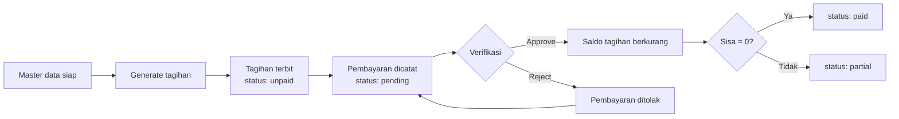

# PRD — KOMITE MAN 7 JOMBANG

**Product Requirements Document**  
Aplikasi Pengelolaan Pembayaran Tagihan Sekolah

| Atribut | Nilai |
|---|---|
| Nama Produk | KOMITE MAN 7 JOMBANG |
| Jenis | Aplikasi web administrasi keuangan sekolah |
| Arsitektur | Laravel Monolithic (Blade + Livewire 3 + Alpine.js + Tailwind CSS) |
| Basis Data | MySQL |
| Mata Uang | IDR (Rupiah) |
| Zona Waktu | Asia/Jakarta |
| Bahasa Antarmuka | Bahasa Indonesia |

---

## 1. Latar Belakang

Pengelolaan pembayaran tagihan sekolah di MAN 7 Jombang masih dilakukan secara
terpisah: pencatatan tagihan pada buku atau spreadsheet, penerimaan pembayaran
melalui beberapa rekening bank, dan rekap laporan yang dibuat manual. Kondisi ini
menyebabkan:

- Data tagihan dan pembayaran tidak saling terhubung.
- Sulit mengetahui sisa tunggakan siswa secara akurat dan real-time.
- Rekapitulasi penerimaan memakan waktu dan rawan kesalahan hitung.
- Riwayat perubahan data tidak terekam sehingga sulit diaudit.
- Orang tua/wali tidak memiliki akses informasi tagihan secara mandiri.

Aplikasi ini hadir untuk menyatukan seluruh proses tersebut dalam satu sistem
terintegrasi dengan basis data tunggal.

---

## 2. Tujuan Produk

1. Menyediakan satu sumber kebenaran untuk seluruh data tagihan dan pembayaran.
2. Menjamin akurasi perhitungan saldo tagihan siswa.
3. Mempercepat proses penagihan, penerimaan, dan verifikasi pembayaran.
4. Menghasilkan laporan keuangan yang dapat dipercaya dan dapat diekspor.
5. Memberikan transparansi tagihan kepada orang tua/wali.
6. Menyediakan jejak audit atas setiap perubahan data penting.

---

## 3. Ruang Lingkup

### 3.1 Termasuk

- Autentikasi dan otorisasi berbasis role & permission.
- Master data: unit pendidikan, tahun ajaran, kelas, siswa, petugas,
  kategori pembayaran, akun keuangan, rekening bank.
- Pengelolaan tagihan: individual, massal, dan bulanan; potongan pembayaran.
- Pembayaran: proses, alokasi multi-tagihan, verifikasi, kwitansi,
  pembatalan & reversal.
- Keuangan: transaksi kas, arus kas, jurnal.
- Laporan: penerimaan, tunggakan, arus kas; ekspor Excel & PDF.
- PPDB: periode, pendaftar, dokumen, tagihan pendaftaran, portal pendaftar.
- Notifikasi WhatsApp dan Email.
- Perkakas sistem: backup basis data, log aktivitas, pengaturan aplikasi.
- Payment gateway: Virtual Account / QRIS dinamis per tagihan dengan verifikasi
  webhook otomatis (Tripay, Midtrans).
- Rekonsiliasi bank otomatis: impor mutasi CSV/Excel dan auto-matching.
- Payroll / honorarium guru & karyawan terhubung ke bagan akun dan kas keluar.
- Bebas tanggungan sebagai prasyarat penerbitan Surat Keterangan Lulus (SKL).

### 3.2 Tidak Termasuk

- Aplikasi mobile native (antarmuka responsif web sudah mencukupi).
- Akuntansi pajak dan pelaporan pajak.
- Manajemen akademik (nilai, absensi, kurikulum).
- Perhitungan PPh 21 / potongan pajak payroll secara otomatis (potongan masih
  diisi manual per slip).

---

## 4. Pengguna dan Peran

| Role | Deskripsi | Cakupan Utama |
|---|---|---|
| Super Administrator | Pemilik sistem | Seluruh modul termasuk pengaturan & backup |
| Administrator | Pengelola operasional | Master data, tagihan, laporan |
| Bendahara | Penanggung jawab keuangan | Tagihan, pembayaran, laporan keuangan |
| Petugas Pembayaran | Penerima pembayaran di front office | Input pembayaran, cetak kwitansi |
| Verifikator | Pemeriksa bukti pembayaran | Verifikasi / penolakan pembayaran |
| Kepala Sekolah | Pengawas | Melihat dashboard dan laporan |
| Operator PPDB | Pengelola penerimaan siswa baru | Modul PPDB |

Menu yang tidak diizinkan tidak ditampilkan, namun penyembunyian menu **bukan**
pengganti otorisasi. Setiap route dan aksi Livewire wajib dilindungi permission.

---

## 5. Kebutuhan Fungsional

### 5.1 Autentikasi & Otorisasi

| ID | Kebutuhan | Prioritas |
|---|---|---|
| F-01 | Pengguna dapat masuk dengan email dan kata sandi | Wajib |
| F-02 | Sistem membatasi percobaan masuk berulang (rate limiting) | Wajib |
| F-03 | Pengguna nonaktif/ditangguhkan tidak dapat mengakses aplikasi | Wajib |
| F-04 | Setiap modul dilindungi permission granular | Wajib |
| F-05 | Pengguna dapat mengubah profil dan kata sandi sendiri | Wajib |

### 5.2 Master Data

| ID | Kebutuhan | Prioritas |
|---|---|---|
| F-10 | CRUD unit pendidikan dengan kode unik | Wajib |
| F-11 | CRUD tahun ajaran dengan satu periode aktif | Wajib |
| F-12 | CRUD kelas terikat unit dan tahun ajaran | Wajib |
| F-13 | CRUD profil petugas dengan relasi ke akun pengguna | Wajib |
| F-14 | CRUD data induk siswa dengan NIS/NISN unik | Wajib |
| F-15 | CRUD kategori pembayaran dengan tarif standar | Wajib |
| F-16 | CRUD akun keuangan (bagan akun) | Wajib |
| F-17 | CRUD rekening bank tujuan pembayaran | Wajib |
| F-18 | Import data siswa dari Excel | Sebaiknya |
| F-19 | Master data yang masih dirujuk tidak dapat dihapus | Wajib |

### 5.3 Tagihan

| ID | Kebutuhan | Prioritas |
|---|---|---|
| F-20 | Membuat tagihan individual per siswa | Wajib |
| F-21 | Membuat tagihan massal per unit/kelas | Wajib |
| F-22 | Membuat tagihan bulanan berulang | Wajib |
| F-23 | Menerapkan potongan (persentase atau nominal) | Wajib |
| F-24 | Mencegah pembuatan tagihan duplikat | Wajib |
| F-25 | Menampilkan sisa tagihan secara akurat | Wajib |
| F-26 | Membatalkan tagihan yang belum memiliki pembayaran | Wajib |

Rumus perhitungan:

```text
Total Tagihan = Nominal Awal - Potongan
Sisa Tagihan  = Total Tagihan - Total Pembayaran Terverifikasi
```

### 5.4 Pembayaran

| ID | Kebutuhan | Prioritas |
|---|---|---|
| F-30 | Mencatat pembayaran dengan nomor transaksi unik | Wajib |
| F-31 | Mendukung pembayaran sebagian (parsial) | Wajib |
| F-32 | Mendukung satu transaksi untuk beberapa tagihan | Wajib |
| F-33 | Mendukung satu tagihan dibayar melalui beberapa transaksi | Wajib |
| F-34 | Verifikasi dan penolakan pembayaran | Wajib |
| F-35 | Hanya pembayaran `approved` yang mengurangi saldo tagihan | Wajib |
| F-36 | Mencetak kwitansi PDF | Wajib |
| F-37 | Pembatalan pembayaran dengan jejak reversal | Wajib |
| F-38 | Unggah bukti pembayaran ke private storage | Wajib |
| F-39 | Mencegah pembayaran ganda akibat request berulang | Wajib |

### 5.5 Laporan

| ID | Kebutuhan | Prioritas |
|---|---|---|
| F-40 | Laporan penerimaan pembayaran per periode | Wajib |
| F-41 | Laporan tunggakan per siswa/kelas/unit | Wajib |
| F-42 | Laporan arus kas | Wajib |
| F-43 | Ekspor laporan ke Excel | Wajib |
| F-44 | Ekspor laporan ke PDF | Wajib |

### 5.6 PPDB

| ID | Kebutuhan | Prioritas |
|---|---|---|
| F-50 | Mengelola periode penerimaan siswa baru | Wajib |
| F-51 | Pendaftaran calon siswa melalui portal publik | Wajib |
| F-52 | Unggah dan verifikasi dokumen pendaftar | Wajib |
| F-53 | Tagihan biaya pendaftaran | Wajib |
| F-54 | Konten informasi PPDB yang dapat diedit | Sebaiknya |

### 5.7 Perkakas Sistem

| ID | Kebutuhan | Prioritas |
|---|---|---|
| F-60 | Pengingat tagihan terjadwal | Wajib |
| F-61 | Notifikasi WhatsApp | Wajib |
| F-62 | Notifikasi Email | Wajib |
| F-63 | Backup dan restore basis data | Wajib |
| F-64 | Log aktivitas pengguna | Wajib |
| F-65 | Pengaturan aplikasi terpusat | Wajib |

### 5.8 Payment Gateway (Tagihan Digital)

| ID | Kebutuhan | Prioritas |
|---|---|---|
| F-70 | Menerbitkan Virtual Account / QRIS dinamis per tagihan siswa | Wajib |
| F-71 | Provider gateway dipilih per unit pendidikan (Tripay / Midtrans) | Wajib |
| F-72 | Verifikasi pembayaran otomatis melalui webhook bertanda tangan | Wajib |
| F-73 | Webhook idempoten — satu transaksi provider hanya menghasilkan satu pembayaran | Wajib |
| F-74 | Nominal tidak cocok tidak di-approve otomatis, melainkan ditandai untuk peninjauan | Wajib |
| F-75 | Daftar tagihan digital beserta status dan masa berlaku | Wajib |
| F-76 | Kedaluwarsa otomatis intent yang melewati `expires_at` | Sebaiknya |

### 5.9 Rekonsiliasi Bank Otomatis

| ID | Kebutuhan | Prioritas |
|---|---|---|
| F-80 | Impor mutasi rekening dari CSV/Excel | Wajib |
| F-81 | Template pemetaan kolom per bank (BSI, BRI, Bank Jatim) dengan opsi override | Wajib |
| F-82 | Auto-matching berbasis kode referensi, nominal unik, dan nominal+tanggal | Wajib |
| F-83 | Pencocokan manual, pembatalan pencocokan, dan penandaan diabaikan | Wajib |
| F-84 | Pencegahan impor berkas yang sama (dedupe `file_hash`) | Wajib |
| F-85 | Ringkasan hasil impor: total baris, tercocokkan, belum, total debit/kredit | Wajib |

### 5.10 Payroll / Honorarium

| ID | Kebutuhan | Prioritas |
|---|---|---|
| F-90 | Mengelola periode honorarium beserta slip per pegawai | Wajib |
| F-91 | Penerima dapat berupa pegawai terdaftar atau nama bebas (insentif komite) | Wajib |
| F-92 | Persetujuan periode membentuk satu transaksi kas keluar dan satu jurnal batch | Wajib |
| F-93 | Jurnal memakai akun beban honorarium dan akun kas pada bagan akun | Wajib |
| F-94 | Pembatalan periode melakukan reversal, bukan penghapusan fisik | Wajib |
| F-95 | Rekap honorarium per jabatan | Sebaiknya |

### 5.11 Bebas Tanggungan & SKL

| ID | Kebutuhan | Prioritas |
|---|---|---|
| F-100 | Pemeriksaan otomatis sisa tanggungan siswa sebagai prasyarat kelulusan | Wajib |
| F-101 | Pemeriksaan massal untuk satu kelas/angkatan | Wajib |
| F-102 | Pengecualian manual oleh pejabat berwenang disertai alasan | Wajib |
| F-103 | Penerbitan Surat Keterangan Lulus bernomor otomatis | Wajib |
| F-104 | Cetak SKL dalam format PDF A4 | Wajib |
| F-105 | SKL hanya dapat dicetak bila status bebas tanggungan dan nomor SKL tersedia | Wajib |

---

## 6. Kebutuhan Non-Fungsional

| ID | Kebutuhan |
|---|---|
| N-01 | **Integritas keuangan** — semua proses saldo memakai `DB::transaction()` dan row locking |
| N-02 | **Keamanan** — password hashing, CSRF, XSS protection, validasi form, otorisasi policy |
| N-03 | **Audit** — setiap perubahan data penting tercatat di `activity_logs` |
| N-04 | **Privasi berkas** — bukti pembayaran di private storage, akses via signed URL |
| N-05 | **Performa** — hindari N+1, gunakan eager loading, index, pagination server-side |
| N-06 | **Responsif** — antarmuka nyaman pada ponsel, tablet, dan desktop |
| N-07 | **Konsistensi UI** — seluruh halaman mengikuti `DESIGN.MD` |
| N-08 | **Keterujian** — setiap fitur keuangan memiliki automated test |
| N-09 | **Tanpa data palsu** — tidak ada tombol dummy atau data hardcoded yang seharusnya dari basis data |
| N-10 | **Keterpeliharaan** — business logic kompleks dipisahkan ke Service/Action, bukan di controller atau Blade |

---

## 7. Alur Proses Utama

### 7.1 Siklus Tagihan hingga Lunas



### 7.2 Pembatalan Pembayaran

Pembatalan **tidak menghapus** catatan asli. Sistem menyimpan transaksi asal,
alasan pembatalan, pengguna pembatal, waktu pembatalan, referensi reversal, dan
status sebelumnya. Saldo tagihan dikembalikan melalui jurnal reversal.

---

## 8. Metrik Keberhasilan

1. Selisih perhitungan saldo tagihan = 0 pada audit bulanan.
2. Waktu rekapitulasi laporan penerimaan turun dari hitungan hari menjadi menit.
3. Seluruh transaksi keuangan memiliki jejak audit yang dapat ditelusuri.
4. Tidak ada pembayaran ganda tercatat.
5. Orang tua/wali dapat memeriksa tagihan secara mandiri.

---

## 9. Batasan dan Asumsi

- Aplikasi dijalankan pada server madrasah atau hosting dengan PHP 8.2+ dan MySQL.
- Koneksi internet tersedia untuk notifikasi WhatsApp dan Email.
- Data awal siswa diimpor dari sistem lama.
- Satu siswa hanya memiliki satu kelas aktif pada satu tahun ajaran.
- Tahun ajaran siswa diturunkan dari kelasnya, bukan disimpan langsung pada
  data siswa.

---

## 10. Dokumen Terkait

| Dokumen | Isi |
|---|---|
| [AGENTS.MD](./AGENTS.MD) | Aturan dan pedoman pengembangan untuk AI Agent |
| [DESIGN.MD](./DESIGN.MD) | Design system, token, dan aturan antarmuka |
| [DATABASE_ERD.md](./DATABASE_ERD.md) | Skema basis data dan relasi antar tabel |
| [IMPLEMENTATION_PLAN.md](./IMPLEMENTATION_PLAN.md) | Rencana dan status implementasi per fase |
| [API_INTEGRATION.md](./API_INTEGRATION.md) | Integrasi WhatsApp, Email, dan payment gateway |
| [DEPLOYMENT.md](./DEPLOYMENT.md) | Panduan instalasi dan deployment |
| [CHANGELOG.md](./CHANGELOG.md) | Riwayat perubahan aplikasi |
